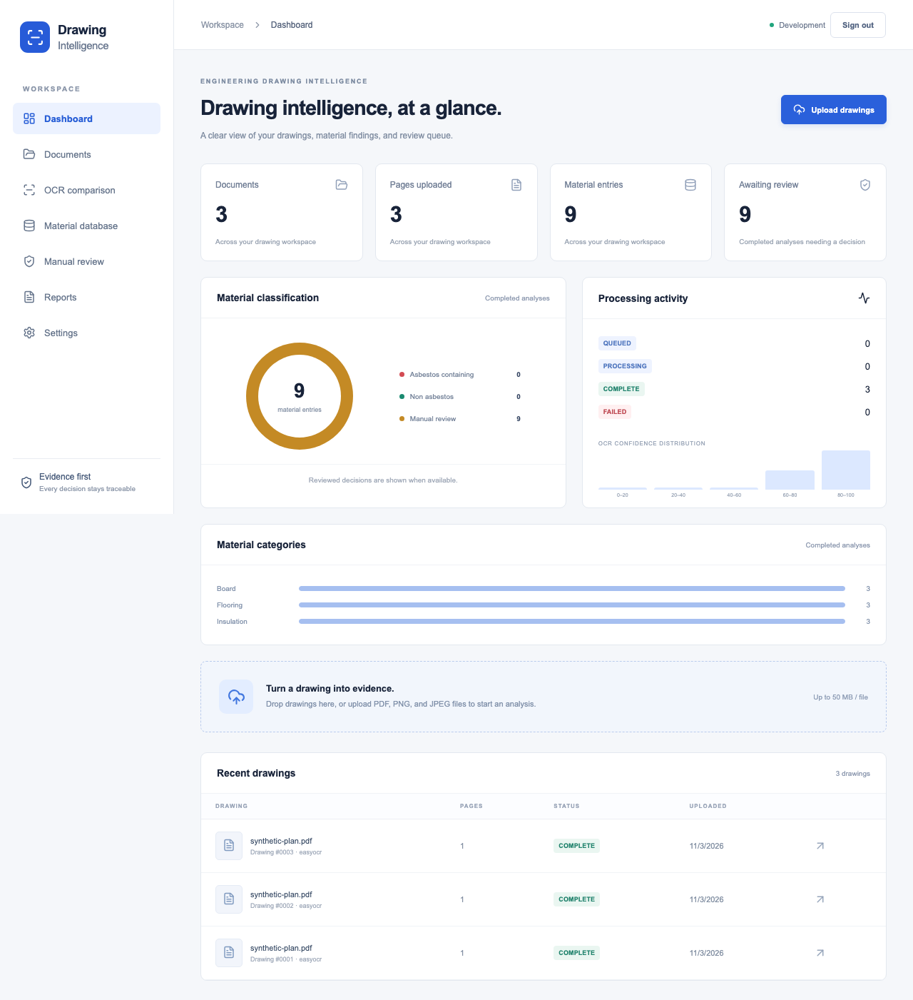
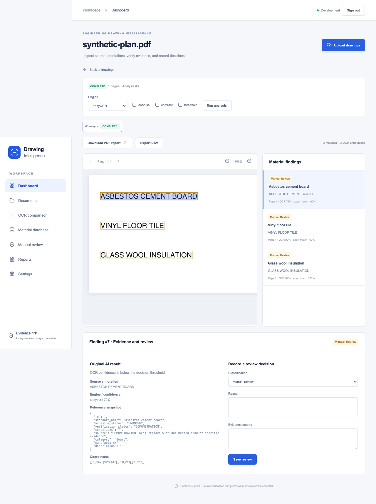

# Engineering Drawing Intelligence

[](https://github.com/Mohitsagar236/engineering-drawing-intelligence/actions/workflows/ci.yml)

**From engineering drawings to traceable material evidence.**

A working application for OCR, material reference matching, and asbestos review. Upload a PDF or scanned drawing, inspect extracted annotations on the original page, compare OCR engines, and record review decisions with supporting sources.



## What you can do

- **Analyze drawings:** PDF, PNG, JPG, and JPEG uploads with progress, content validation, page limits, and bounded rendering.
- **Run real OCR:** EasyOCR and PaddleOCR on CPU, with English recognition and configurable Japanese model settings.
- **Inspect the evidence:** page navigation, zoom, clickable OCR polygons, confidence, source annotations, match scores, and reference snapshots.
- **Compare engines:** retain separate analysis runs and inspect each engine's output side by side.
- **Manage references:** create, edit, verify, and import/export material catalog records, including manufacturer, conditions, source, and update date.
- **Review findings:** save a reason and evidence source for each human decision while preserving the original AI result.
- **Export reports:** downloadable PDF and CSV reports, including historical analysis runs.
- **Organize and search:** group drawings into projects, add tags, and filter by file name, tag, status, project, or recognized OCR text.
- **Extract drawing data:** heuristic title block fields, dimensions (diameter, radius, thread, angle, tolerance), and bill-of-materials tables, each linked to its source annotation and exportable to CSV.
- **Report in bulk:** project summary PDFs with classification, category, and confidence charts; combined CSV and ZIP-of-PDF exports for any selection of up to 50 drawings.
- **Audit everything:** a filterable, paginated audit log viewer covering uploads, reprocessing, reviews, catalog changes, and project edits.
- **Monitor processing:** database-backed dashboard counts, classification distribution, OCR confidence, status, failures, and processing history.



## Evidence-based classification

| Result | Required evidence |
| --- | --- |
| Asbestos containing | A unique exact match to an explicitly verified positive reference, sufficient OCR confidence, and no unresolved conditions. |
| Non asbestos | A unique exact match to an explicitly verified negative reference, sufficient OCR confidence, and no unresolved conditions. |
| Manual review | Low confidence, fuzzy-only matches, conflicting aliases, unknown status, demonstration records, or unresolved conditions. |

Fuzzy similarity suggests candidates; it never establishes asbestos status. Seed records are labeled **DEMONSTRATION** and have **UNKNOWN** status. CSV imports remain **UNVERIFIED** until individually reviewed. Every classification stores its reference snapshot and explanation.

## Architecture

```text
Browser / Next.js
        │ same-origin API proxy
        ▼
FastAPI ───────────── SQLAlchemy / SQLite or PostgreSQL
        │                    │
        │ upload             ├── reference catalog
        └── durable queue    ├── OCR evidence and analysis history
                │            └── reviews and audit records
                ▼
        Single dispatcher
                │ bounded inference subprocess
                ▼
  PyMuPDF → OpenCV → EasyOCR / PaddleOCR
                │
                ▼
  Page images + OCR polygons + material matching
```

The release targets one authenticated workspace with one dispatcher. Signed browser sessions, login throttling, HTTP Basic API access, upload limits, schema migrations, persistent volumes, and a compiled frontend are included. See the [deployment runbook](docs/DEPLOYMENT.md) for HTTPS, secrets, backups, recovery, and scaling boundaries.

## Quick start

Requires **Python 3.11** and **Node.js 22**. For a supervised, isolated local stack,
run `python3.11 scripts/local.py setup --provision-models` followed by
`python3.11 scripts/local.py run` from the repository root. See the
[local deployment instructions](docs/DEPLOYMENT.md#local-development) for alternate
ports and workstation runtime paths.

### 1. Backend

```bash
git clone https://github.com/Mohitsagar236/engineering-drawing-intelligence.git
cd engineering-drawing-intelligence/backend
python3.11 -m venv .venv
source .venv/bin/activate
pip install --require-hashes -r requirements.lock
pip install -c requirements.lock -r requirements-dev.txt -r requirements-easyocr.txt
cp .env.example .env
alembic upgrade head
PYTHONPATH=. python scripts/provision_models.py --engine easyocr
uvicorn app.main:app --reload --port 8000
```

### 2. Processing worker

In another terminal, use the same environment and working directory:

```bash
cd backend
source .venv/bin/activate
python -m app.worker
```

### 3. Frontend

```bash
cd frontend
npm ci
npm run dev
```

Open **http://localhost:3000**. API documentation is at **http://localhost:8000/docs**.

Uploads stay queued until the worker is running. OCR weights download during provisioning; preserve the model cache for offline operation.

### PaddleOCR

```bash
cd backend
source .venv/bin/activate
pip install -c requirements.lock -r requirements-ocr.txt
PYTHONPATH=. python scripts/provision_models.py --engine paddleocr
```

Set `OCR_LANGUAGES=ja,en` for EasyOCR Japanese recognition. PaddleOCR requires a single language: `OCR_LANGUAGES=ja` maps to its `japan` model. Japanese accuracy has not been evaluated on field drawings.

### Docker Compose

```bash
cp backend/.env.example backend/.env
docker compose up --build -d
docker compose run --rm backend python scripts/provision_models.py --engine easyocr
```

Compose builds the production frontend, migrates the database, starts the API and worker, and persists uploads, pages, and model weights. The frontend binds to localhost:3000. Enable PaddleOCR with `INSTALL_PADDLE=true` when building. Public deployment requires HTTPS and the mandatory-secret `docker-compose.production.yml` override; see [DEPLOYMENT.md](docs/DEPLOYMENT.md#private-deployment).

## API examples

```bash
# Queue a drawing
curl -F "file=@drawing.pdf" http://localhost:8000/api/documents/upload

# Inspect status and results
curl http://localhost:8000/api/documents/1
curl http://localhost:8000/api/documents/1/results

# Download PDF or CSV
curl -o report.pdf http://localhost:8000/api/documents/1/report
curl -o findings.csv 'http://localhost:8000/api/documents/1/report?format=csv'
```

Authenticated deployments support HTTP Basic for API clients. Interactive docs cover processing, comparison, materials, imports, reviews, audit history, and dashboard endpoints.

## Verification

```bash
cd backend
PYTHONPATH=. pytest -q tests
ruff check app tests scripts
alembic check
pip-audit

# Real inference on a reproducible synthetic drawing
PYTHONPATH=. python scripts/evaluate.py --engine easyocr
PYTHONPATH=. python scripts/evaluate.py --engine paddleocr

# Synthetic rule metrics: precision, recall, F1, confusion matrix
PYTHONPATH=. python scripts/evaluate_matching.py

# Complete live API → worker → OCR → PDF/CSV flow
python scripts/smoke.py
```

The browser suite runs against a live stack after the smoke test creates its sample drawing:

```bash
cd frontend
npm run build
npx playwright install chromium
npm run test:e2e
```

Both engines correctly extracted all three annotations in the clean synthetic OCR fixture during local validation (CER 0, WER 0). These results measure that fixture only and are **not field accuracy claims**. Real scanned, rotated, handwritten, and Japanese drawings require a representative evaluation dataset.

## Project structure

```text
backend/
  app/core/           Configuration, sessions, upload protection
  app/models/         Documents, jobs, references, evidence, reviews, audit
  app/services/       Rendering, preprocessing, OCR, matching, PDF reports
  app/worker.py       Durable dispatcher and isolated inference
  migrations/         Versioned Alembic schema
  scripts/            Model provisioning, evaluation, live smoke test
  tests/              Isolated API, classification, and security tests
frontend/
  app/                Dashboard, drawing viewer, reference and review UI
  tests/              Playwright browser checks
docs/
  DEPLOYMENT.md       Deployment and recovery runbook
docker-compose.yml
```

## Scope and limitations

The application provides decision support and source traceability. It does not establish the absence of asbestos from a drawing alone. Real reference data must come from documented sources, and decisions require professional verification.

The current deployment model uses one configured reviewer identity and one worker. Per-user accounts, tenant isolation, automatic retention policies, and horizontal inference scaling are future extensions. PostgreSQL configuration is supported; the local end-to-end validation uses SQLite.
